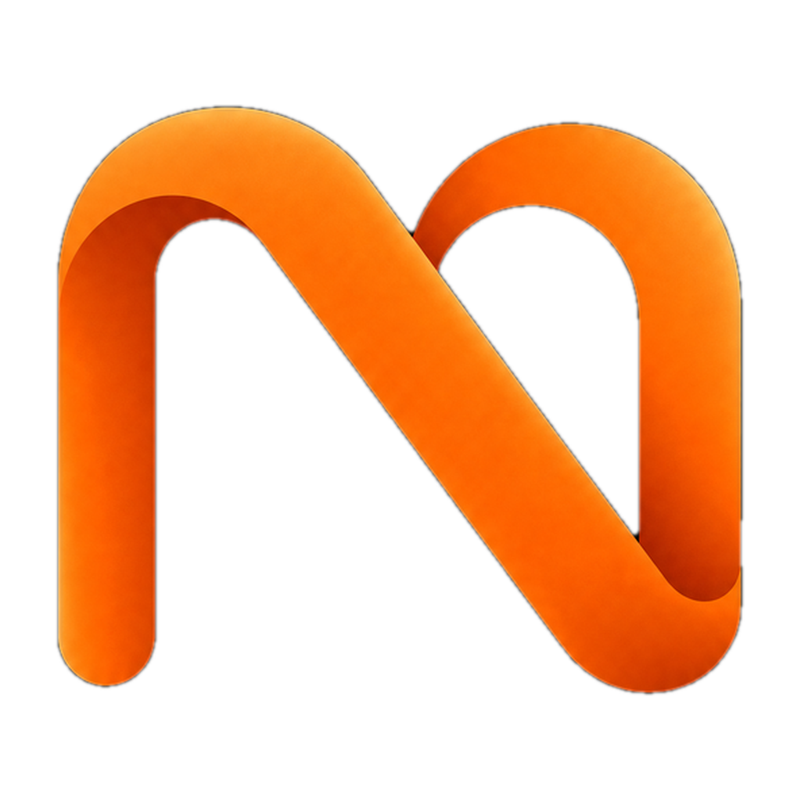
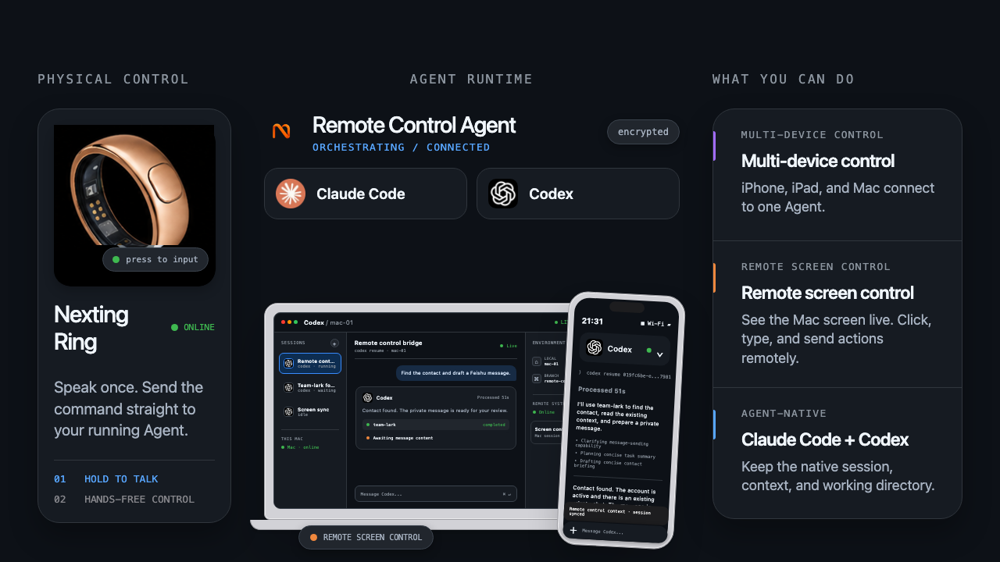
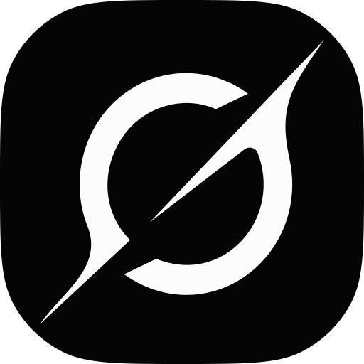
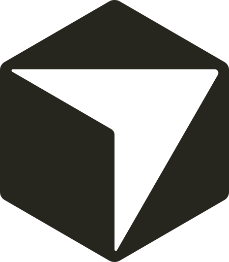
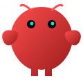

<p align="center">
  
</p>

<h1 align="center">Nexting</h1>

<p align="center">
  <strong>Remote control for your own AI agents.</strong><br>
  Connect to Claude Code, Codex, Grok, and Cursor on your Mac or Windows PC.<br>
  View sessions, send tasks, and drive them remotely from your phone.
</p>

<p align="center">
  <a href="https://nexting.ai">Website</a> ·
  <a href="https://apps.apple.com/us/app/nexting-wearable-ai-agent/id6760344343">App Store</a> ·
  <a href="https://nexting.ai/doc">Docs</a>
</p>

<p align="center">
  <a href="https://www.npmjs.com/package/pinclaw"></a>
</p>

---

<p align="center">
  
</p>

You already have powerful agents — Claude Code, Codex, Grok, Cursor, OpenClaw — running on your computer. **Nexting connects you to them remotely**: view live sessions, send tasks, and drive Claude Code, Codex, Grok, or Cursor from your phone, wherever you are. When you only need to send an idea, speak once and let your own agent work in the background.

**Remote control, not just dispatch — view, send, drive.**

Nexting is software first: the apps and the agent connections are the product. Hardware is an optional way in.

- **[Nexting Ring](https://nexting.ai/ring)** — in development. Hold a button to speak, move the pointer with your thumb, and flip a switch to choose your phone or your Mac.
- **PIN** — an open DIY side project. The firmware, enclosure files, and schematic are in [`hardware-opensource/`](hardware-opensource/) for anyone to build. We don't sell it.

```
You speak → phone or wearable → Nexting app (STT) → Cloud → your own agent
                                                          (Claude Code / Codex / Grok / Cursor / OpenClaw)
                                                               ↓
 Result pushed back ← Nexting app ← ── ── agent runs it in the background
```

**3 seconds to dispatch a task** — vs. ~30s pulling out your phone, unlocking, and typing.

## What Makes Nexting Different

| | |
|---|---|
| **Remote control** | Attach to a Claude Code, Codex, Grok, or Cursor session on your Mac or Windows PC, view it live, send tasks, and drive it remotely from your phone or wearable. |
| **Dispatch, not chat** | Fire-and-forget: say it once, your agent runs it in the background. Not Q&A. |
| **Your own agent** | Drives the agents you already run — Claude Code, Codex, Grok, Cursor, OpenClaw. Not a locked-in model. |
| **Private by design** | Claude Code, Codex, Grok, and Cursor support optional end-to-end encryption — turn it on and Nexting relays ciphertext, not your session. |
| **Delivers while you're offline** | Phone locked, on the move? The agent still finishes the job and pushes the result back. |
| **Deep iPhone integration** | Calendar, Reminders, Contacts, Health, HomeKit — all by voice. |

Nexting isn't another voice assistant — it's the pocket control surface for your agent team.

## Get Started

1. **Install the [Nexting iOS app](https://apps.apple.com/us/app/nexting-wearable-ai-agent/id6760344343)** and sign in.
2. **Connect your agent** — Claude Code, Codex, Grok, Cursor, OpenClaw, a local model, or managed Nexting Pro (see below).
3. **Send a task** from your phone, by text or voice.

No hardware is required. If you build a PIN from [`hardware-opensource/`](hardware-opensource/), pair it over Bluetooth in the app.

## Bring Your Own Agent

Nexting is a terminal, not a model. Connect the agent you already run:

| Mode | What It Is | Cost |
|------|-----------|------|
| **Claude Code** | Attach to a [Claude Code](https://claude.com/product/claude-code) session on your Mac or Windows PC and drive it from your phone — live. | Free |
| **Codex** | Attach to an OpenAI Codex CLI session on your Mac or Windows PC and drive it from your phone — live. | Free |
| **Grok** | Attach to a [Grok Build](https://grok.com) session on your Mac and drive it from your phone — live. | Free |
| **Cursor** | Attach to a [Cursor](https://cursor.com) Desktop session on your Mac and drive it from your phone — live. | Free |
| **MyOpenClaw** | Run your own [OpenClaw](https://github.com/openclaw/openclaw) instance. We handle the relay. | Free |
| **MyHermes** | Any OpenAI-compatible local AI — Hermes Agent, Ollama, vLLM, LM Studio. | Free |
| **Nexting Pro** | Managed agent in the cloud. Latest Claude, GPT, and Gemini models, zero setup. | $29/mo or $279/yr |

Dispatch to whichever agent is yours. Expand your mode below for setup — each takes about a minute.

<details>
<summary> <strong>Claude Code</strong> — your Mac/PC sessions, mirrored to your phone, driveable live</summary>
<br>

One command on the computer where Claude Code runs. It opens your browser to sign in to Nexting — that login binds the machine to your account — and installs everything, including a background daemon that keeps your phone connected.

**macOS**

```bash
curl -fsSL https://nexting.ai/install-cc | bash
```

**Windows (PowerShell)**

```powershell
irm https://nexting.ai/install-cc.ps1 | iex
```

Then just run `claude` as usual (on Windows, fully quit and reopen your terminal first) — your sessions appear in the Nexting app, live. Uninstall anytime: `nexting-cc-bridge uninstall`.

</details>

<details>
<summary> <strong>Codex</strong> — same idea, for the OpenAI Codex CLI</summary>
<br>

One command to sign in and install:

**macOS**

```bash
curl -fsSL https://nexting.ai/install-codex | bash
```

**Windows (PowerShell)**

```powershell
irm https://nexting.ai/install-codex.ps1 | iex
```

Then just run `codex` as usual — your sessions appear in the Nexting app, live. Uninstall anytime: `nexting-cc-bridge codex-uninstall`.

</details>

<details>
<summary> <strong>Grok</strong> — same idea, for Grok Build on your Mac</summary>
<br>

One command to sign in and install:

```bash
curl -fsSL https://nexting.ai/install-grok | bash
```

Then just run `grok` as usual — your sessions appear in the Nexting app, live. Uninstall anytime: `nexting-cc-bridge grok-uninstall`.

</details>

<details>
<summary> <strong>Cursor</strong> — same idea, for Cursor Desktop on your Mac</summary>
<br>

One command to sign in and install:

```bash
curl -fsSL https://nexting.ai/install-cursor | bash
```

Your Cursor Desktop sessions appear in the Nexting app, live. Uninstall anytime: `nexting-cc-bridge cursor-uninstall`.

</details>

<details>
<summary> <strong>MyOpenClaw</strong> — run your own OpenClaw; we handle the relay</summary>
<br>

Nexting connects to your own [OpenClaw](https://github.com/openclaw/openclaw) instance. Install the plugin and link your account:

```bash
openclaw plugins install pinclaw --dangerously-force-unsafe-install
openclaw pinclaw login
```

> The npm package and CLI commands use the internal codename `pinclaw` — that's by design, not a leftover. Full plugin docs: [`plugin/README.md`](plugin/README.md).

</details>

<details>
<summary> <strong>MyHermes</strong> — any OpenAI-compatible local AI (Ollama, vLLM, LM Studio…)</summary>
<br>

Point Nexting at your local endpoint with the `nexting-hermes-bridge` CLI:

```bash
npm install -g nexting-hermes-bridge
nexting-hermes-bridge login
nexting-hermes-bridge start --endpoint http://localhost:8642 --model hermes-agent
```

</details>

<details>
<summary> <strong>Nexting Pro</strong> — managed agent in the cloud, nothing to install</summary>
<br>

Subscribe in the Nexting app and it's ready to dispatch.

</details>

Full walkthrough for every mode — pairing, remote control, starting sessions by voice: [nexting.ai/doc](https://nexting.ai/doc).

## Open Hardware: Build a PIN

The PIN is a clip-on voice button you can build yourself. Nexting does not sell it; the design is published here as a DIY project. No screen — by design.

| Spec | Detail |
|------|--------|
| MCU | Seeed XIAO nRF52840 Sense (ARM Cortex-M4 @ 64MHz) |
| Microphone | PDM MEMS (built into XIAO Sense) |
| Audio | Opus codec over BLE 5.0, I2S speaker (MAX98357A) |
| Feedback | RGB LED + speaker (no screen) |
| Battery | 3.7V LiPo, USB-C charging (onboard BQ25101) |
| Firmware | Zephyr RTOS v2.2.0 ([source + UF2](hardware-opensource/firmware/pinclaw_zephyr/)) |
| Interaction | Single-button push-to-talk |

The [`hardware-opensource/`](hardware-opensource/) directory is a complete **Co-Builder Edition**: firmware source, 3D-printable enclosure files, and a schematic PDF — everything you need to build a PIN yourself. Flash the UF2 binary via drag-and-drop — no programmer needed.

## iPhone Integration

Your phone isn't just a pipe — it's the bridge between you and your AI. The Nexting app registers native iOS capabilities as skills your agent can call:

- **Calendar** — Read and create events
- **Reminders** — Manage tasks and to-do lists
- **Contacts** — Look up people
- **Health** — Access HealthKit data
- **HomeKit** — Control smart home devices
- **Location** — Context-aware responses
- **Timer** — Set and manage timers

Say "schedule a meeting tomorrow at 3pm" — the agent calls your iPhone's calendar directly.

All data stays on your iPhone. You control every permission.

## Privacy

- Claude Code, Codex, Grok, and Cursor support **end-to-end encryption** (opt-in) — with it enabled, Nexting relays ciphertext, not readable session content
- Raw audio is discarded immediately after transcription — never stored
- Voice streams over encrypted WebSocket (WSS)
- Self-hosted modes keep all data on your own infrastructure
- No always-on listening — recording only while the button is held
- We never train on your data, never sell it, never share it — and you can delete it anytime

## Repository Structure

```
nexting/
├── hardware-opensource/       # DIY PIN (Co-Builder Edition)
│   ├── firmware/              #   Zephyr firmware (source + UF2 binary)
│   ├── enclosure/             #   3D printing files (STL + OpenSCAD)
│   └── docs/                  #   Schematic PDF
├── plugin/                    # OpenClaw channel plugin (npm package)
├── agent-bus/                 # Multi-agent team bus (wake local agents from one Lark group)
└── public/                    # Product assets
```

> The codename `pinclaw` persists in package names, file paths, and identifiers — it's the permanent internal handle. **Nexting** is the brand. Both coexisting is intentional.

## Links

| | |
|---|---|
| Website | [nexting.ai](https://nexting.ai) |
| iOS App | [App Store](https://apps.apple.com/us/app/nexting-wearable-ai-agent/id6760344343) |
| Docs | [nexting.ai/doc](https://nexting.ai/doc) |
| Nexting Ring | [nexting.ai/ring](https://nexting.ai/ring) |

## Contributing

Issues and pull requests welcome.

## License

MIT

---

<p align="center">
  <strong>Tap. Speak. Dispatch.</strong><br>
  <a href="https://nexting.ai">nexting.ai →</a>
</p>

<!-- nexting-devices:start -->

## Build hardware for Nexting

The open hardware protocol, C99 device SDK, conformance vectors, and reference
firmware live in [`devices/`](devices/).

- Start with the [Devices SDK overview](devices/README.md).
- Read the [wire protocol](devices/SPEC.md).
- Follow the [0.2 migration guide](devices/docs/migration-0.1-to-0.2.md).

Experimental 0.2 supports extensible device identity, buttons, rotary controls,
displays, haptics, battery reporting, and vendor-defined facts while keeping
approval decisions bounded by the trusted Nexting host.

<!-- nexting-devices:end -->
